# دواك (Dawak)

**تطبيق جوال يربط المرضى بالصيدليات: ابحث عن دوائك، اعرف أي صيدلية عندها وبكم، واطلبه لحد البيت. والصيدلية تدير منتجاتها وطلباتها ومحاسبتها من نفس التطبيق.**

**العربية** · [English](README.md)

تطبيق واحد وحسابين: **مستخدم** (المريض: يبحث ويطلب ويتابع) و**صيدلي** (يدير المنتجات والطلبات والمراسلات والمحاسبة). بالعربي من اليمين لليسار، وفيه وضع إنجليزي من الإعدادات.

## الصور

من النسخة الحقيقية (ريليز) على محاكي أندرويد. الصور داخل تعريف الصيدلية مرسومة بنفس ودجتات التطبيق وبتتحرك.

| اختيار الحساب | دخول المستخدم | دخول الصيدلية | إنشاء حساب صيدلية |
|:--:|:--:|:--:|:--:|
| 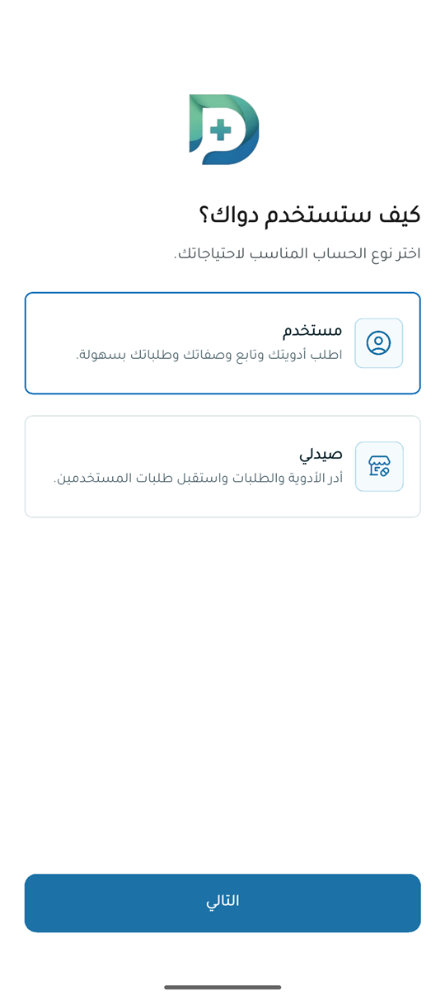 | 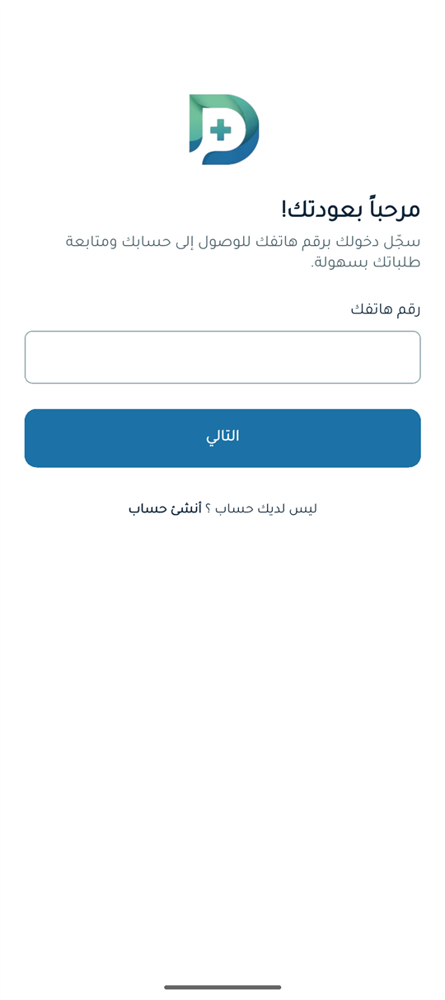 | 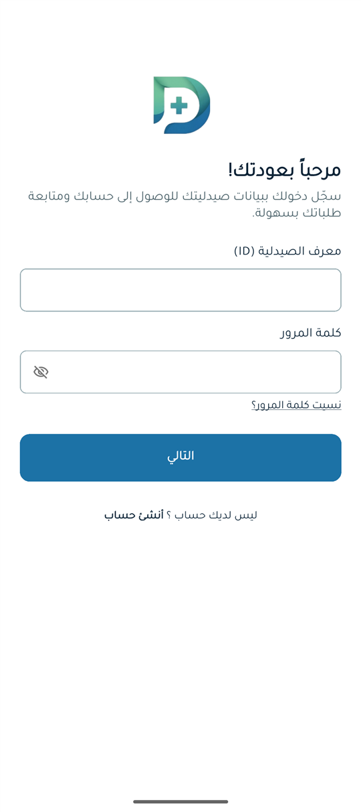 | 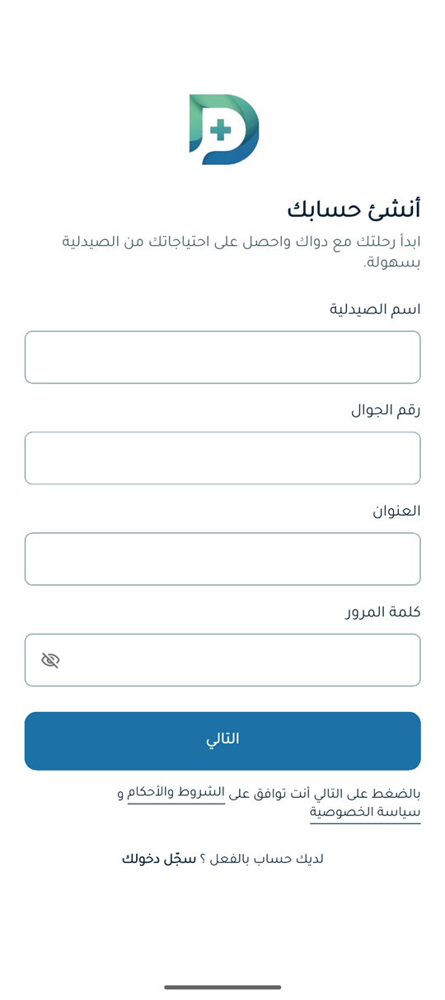 |

| تعريف المستخدم | | | تعريف الصيدلية | | |
|:--:|:--:|:--:|:--:|:--:|:--:|
| 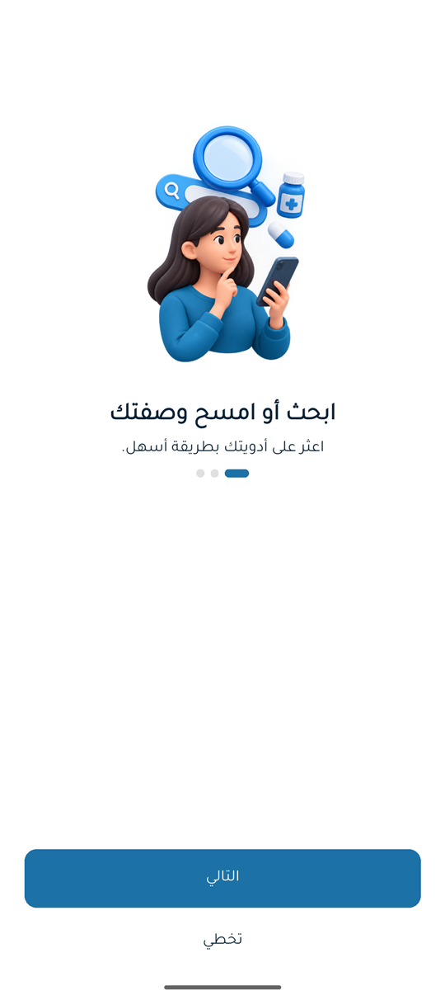 | 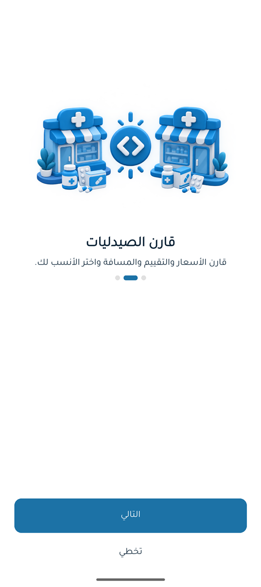 | 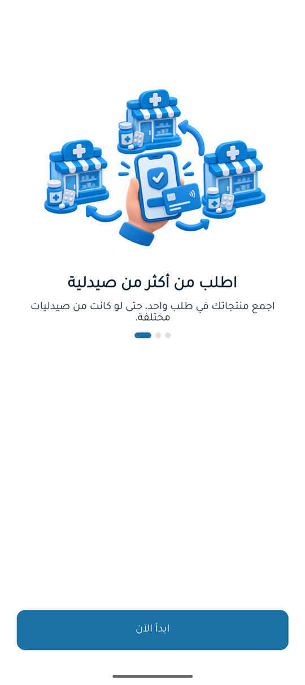 | 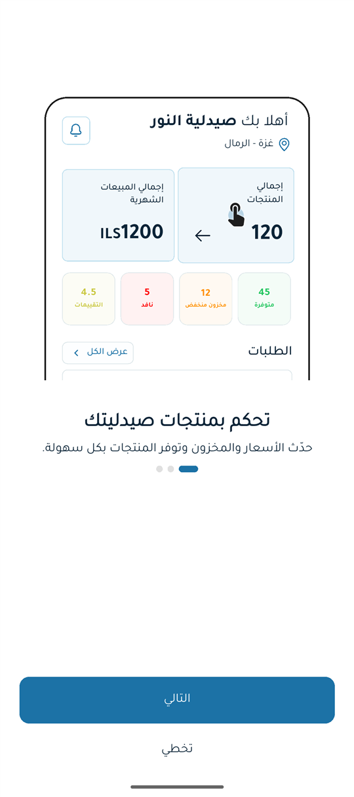 |  | 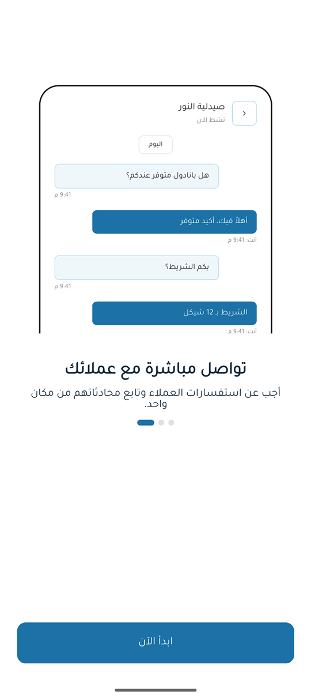 |

## الميزات

**المستخدم**
- بحث باسم الدواء أو بالأعراض، تصفح الأقسام، فلتر حسب شكل الدواء.
- أي صيدليات عندها الدواء، بالسعر والمسافة وهل هي مفتوحة، وتنبيه لما يتوفر.
- اسأل الصيدلية قبل الشراء، ومراسلات مع الصيدليات ومساعد ذكي.
- المفضلة، خريطة الصيدليات القريبة، تذكير الأدوية، الملف الصحي، العناوين.
- سلة (صيدلية وحدة لكل طلب)، سعر التوصيل قبل التأكيد، دفع بتحويل بنكي مع رفع الإشعار، تتبع الطلب، تقييم الصيدلية.
- الإعدادات: اللغة، الأذونات، الدعم، حذف الحساب.

**الصيدلية** (بتنضم بإنشاء حساب، وإدارة دواك بتوافق وبترسل المعرّف وكلمة المرور)
- رئيسية بالأرقام المهمة وأحدث الطلبات.
- المنتجات: إضافة وتعديل وحذف وتعديل الكميات، تحديث بملف Excel، وبدائل للأدوية النافدة.
- الطلبات (عرض فقط)، مراسلات المرضى، التقييمات.
- المحاسبة: مبيعات وفواتير PDF، إرجاعات، صندوق، والهاتف كماسح باركود.
- الإعدادات: البيانات، الموقع، ساعات العمل، كلمة المرور، إغلاق الحساب.

## الحالة

- **شغال:** الحسابان، الطلب بتحويل بنكي، التتبع، المراسلات، المخزون، المحاسبة، الوضع الإنجليزي.
- **لسا:** تاب المسح الضوئي (يحتاج API صورة إلى منتج)، إرسال الروشتة لصيدلية، «نسيت كلمة المرور» للصيدلية (الباك بدون endpoints)، تحريك حالة الطلب من الصيدلية، الدفع بالبطاقة.
- **مؤقت:** رمز التحقق بيظهر على الشاشة لحد ما يتفعّل الـ SMS.

## للمبرمجين

**التقنيات:** Flutter (stable، جُرّب على 3.47) وDart `^3.10.7`؛ `flutter_bloc` (Cubit فقط)، `get_it`، `dio`، `flutter_secure_storage`، Firebase Messaging، Google Maps، `mobile_scanner`، `pdf`. بدون توليد كود: لا Freezed ولا build_runner.

**المعمارية:** Clean Architecture باتجاه واحد.

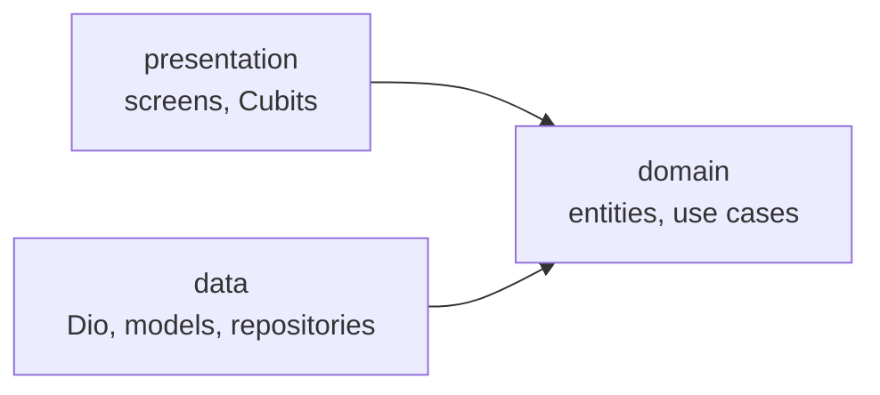

- الـ Cubit بيعتمد على **الـ use cases فقط**. والـ `domain` Dart صرف (بدون `package:flutter`).
- الـ `data` بيلتقط الاستثناءات وبيرجّع `ApiResult<T>` (`Success` / `ApiError`).
- أي كود بيتكرر بمكانين مكانه `core/`.

```
lib/
├─ core/        di, networking, erroring, localization, routing, theming, widgets, helpers
└─ features/    auth, patient, pharmacy, accounting, chat, scanner, onboarding, localization
                كل ميزة: data/ (datasources, models, repositories)
                         domain/ (entities, repositories, usecases)
                         presentation/ (cubit, screens, widgets)
test/           نفس بنية lib؛ وفيه test/helpers للـ fakes المشتركة
```

**التشغيل**

```bash
git clone https://github.com/daway-app/daway-mobile.git && cd daway-mobile
cp .env.example .env     # API_BASE_URL (ينتهي بـ /api) وقيم Cloudinary
flutter pub get
flutter run
```

أضف `MAPS_API_KEY=...` في `android/local.properties`. الملفان `.env` و`local.properties` خارج git؛ والـ `.env` بينحزم داخل التطبيق فلا تحط فيه أسراراً.

```bash
flutter analyze          # لازم يكون نظيف
flutter test             # ~1600 اختبار
flutter run --dart-define=ACCOUNTING_SAMPLE=true      # المحاسبة ببيانات تجريبية
flutter build apk --release --target-platform android-arm64 --split-per-abi \
  --obfuscate --split-debug-info=build/symbols        # ريليز صغير، حوالي 38 ميغا
```

توقيع الريليز: انسخ `android/key.properties.example` إلى `android/key.properties` (والـ keystore خارج المشروع). بدونه بيتوقّع بمفتاح debug.

**الباك إند**
- المسارات في `lib/core/constants/api_constants.dart`؛ المصادقة `Authorization: Bearer <token>`؛ والرد `{ success, message, data, pagination? }`.
- أي 401 على طلب فيه توكن بيمسح الجلسة وبيرجّع لاختيار الحساب. وأخطاء 5xx بتعرض رسالة التطبيق مش رسالة السيرفر.
- `ResponseCacheInterceptor` بيحفظ ردود GET لمسارات محددة (حد أقصى 2 ميغا، وبيتمسح مع الجلسة).
- الدفع: `POST /patient/checkout/quote` ثم حقول `quoted_*` مع `idempotency_key`. مراحل الطلب: [BACKEND_ORDER_FLOW.md](BACKEND_ORDER_FLOW.md).

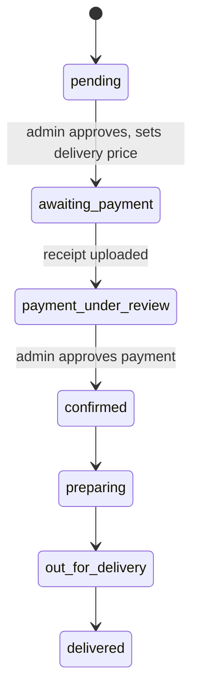

**الترجمة.** النصوص بالعربي مع `.tr` (`'نص {0}'.trArgs([x])`)، والإنجليزي بجداول في `lib/core/localization/en/` مفاتيحها النص العربي. اختبار بيفشل إذا في نص `.tr` بدون إنجليزي. لا `const` حول `.tr`، ولا `.tr` على نص بينرسل للباك. استخدم `start`/`end` (مش `left`/`right`) و`MirrorWhenLtr` للأسهم.

**قواعد الكود**
- أصغر تغيير يحل المشكلة؛ وحل السبب مش العرض.
- استخدم الأدوات المشتركة: `withSessionToken` (use cases)، `guardApi` (ريبوزيتوري)، `authFieldDecoration()`، `networkImage()`.
- `const` قدر الإمكان؛ لا controllers داخل `build()`؛ و`setState` للحالة المحلية فقط.
- اختبارات للـ domain والـ data؛ وإصلاح bug معه اختبار يعيد المشكلة؛ وسلوك واحد لكل اختبار.

**الأمان.** لا أسرار بالكود أو git؛ النسخ الاحتياطي والـ cleartext معطّلان؛ والتذكيرات بالـ secure storage. مفتوح: تقييد مفتاح Maps والـ preset بـ Cloudinary، وحد محاولات `/otp/send` و`/login/pharmacy`.

**Git.** فروع `feature/` و`fix/` و`refactor/` و`docs/` من `develop`. الـ CI (`.github/workflows/dart.yml`) بيشغّل `flutter analyze` و`flutter test` على كل push و PR على `develop`.

المستودع: <https://github.com/daway-app/daway-mobile>
