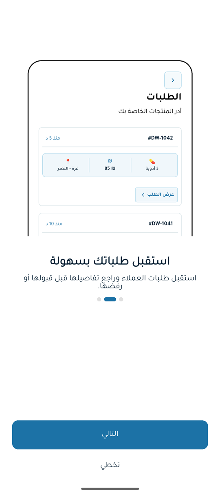

# دواك (Dawak) 💊

**تطبيق جوال يربط المرضى بالصيدليات: ابحث عن دوائك، اعرف أي صيدلية عندها وبكم، واطلبه لحد البيت. والصيدلية تدير منتجاتها وطلباتها ومحاسبتها من نفس التطبيق.**

> *In English:* Dawak is a Flutter mobile app (Android / iOS) with two accounts in one: **patients** search for medicines, compare pharmacies and order with delivery; **pharmacies** manage stock, orders, chat and accounting. Clean Architecture, Cubit/Bloc, `get_it`, Dio. The UI is Arabic-first (RTL) with an English mode. Developer docs are in [section 5](#5-للمبرمجين).

🌐 **العربية** · [English](README.md)

<p align="center">
  
  
  
  
</p>

## المحتويات

1. [ما هو دواك؟](#1-ما-هو-دواك) · [الصور](#الصور)
2. [للمستخدم (المريض)](#2-للمستخدم-المريض)
3. [للصيدلية (العميل)](#3-للصيدلية-العميل)
4. [حالة المشروع: ما يشتغل وما هو قادم](#4-حالة-المشروع)
5. [للمبرمجين](#5-للمبرمجين)
   - [التقنيات](#51-التقنيات) · [المعمارية](#52-المعمارية) · [هيكل المجلدات](#53-هيكل-المجلدات) · [التشغيل](#54-التشغيل-لأول-مرة) · [الأوامر](#55-أوامر-مهمة) · [الباك إند](#56-الاتصال-بالباك-إند) · [الترجمة](#57-الترجمة) · [قواعد الكود](#58-قواعد-الكود) · [الاختبارات](#59-الاختبارات) · [الأمان](#510-الأمان) · [Git](#511-سير-العمل-مع-git) · [إضافة ميزة جديدة](#512-إضافة-ميزة-جديدة)

---

## 1) ما هو دواك؟

**المشكلة:** لما تحتاج دواء، بتلف على أكتر من صيدلية وبتتصل وتسأل «موجود عندكم؟»، وغالباً بتضيّع وقت. والصيدلية من جهتها بتدير مخزونها وطلباتها ورقياً أو بأدوات متفرقة.

**الحل:** تطبيق واحد فيه حسابين:

| الحساب | مين بيستخدمه | شو بيعمل فيه |
|---|---|---|
| **مستخدم** | المريض أو أي شخص بدو دواء | يبحث، يقارن الصيدليات، يطلب، يتابع طلبه |
| **صيدلي** | صاحب الصيدلية أو موظفها | يدير المنتجات والمخزون والطلبات والمراسلات والمحاسبة |

التطبيق يشتغل بالعربي (من اليمين لليسار) وفيه وضع إنجليزي من **الإعدادات ← اللغة**.

---

## الصور

لقطات من النسخة الحقيقية (ريليز) شغّالة على محاكي أندرويد (Pixel 9). الصور داخل شاشات تعريف الصيدلية مرسومة بنفس ودجتات التطبيق، وبتتحرك: إصبع بيضغط على كرت المنتجات، وكروت الطلبات بتنزل، ورسائل المحادثة بتجي وحدة ورا وحدة.

**الدخول**

| اختيار الحساب | دخول المستخدم | دخول الصيدلية | إنشاء حساب صيدلية |
|:--:|:--:|:--:|:--:|
|  |  |  |  |

**تعريف المستخدم**

| ابحث أو امسح | قارن الصيدليات | اطلب من أكتر من صيدلية |
|:--:|:--:|:--:|
|  |  |  |

**تعريف الصيدلية**

| تحكم بمنتجاتك | استقبل طلباتك | تواصل مع عملائك |
|:--:|:--:|:--:|
|  |  |  |

---

## 2) للمستخدم (المريض)

### كيف أبدأ؟
1. افتح التطبيق واختر **مستخدم**.
2. اكتب رقم جوالك (يبدأ بـ `05` ومن 10 أرقام) واطلب رمز التحقق، ثم أدخله.
3. إذا كانت أول مرة، اكتب اسمك وتاريخ ميلادك ووافق على الشروط، ثم اسمح للتطبيق بالموقع (يساعدك تلاقي أقرب صيدلية) وبالإشعارات.

### شو بقدر أعمل؟

| الميزة | الوصف |
|---|---|
| **البحث** | اكتب اسم الدواء أو اكتب «بماذا تشعر». أو تصفح الأقسام: أدوية، العناية بالأسنان، الإسعافات الأولية، الأم والطفل، البشرة والجمال، مستلزمات طبية، العناية بالعين، الصحة والسلامة، فيتامينات ومكملات. وفي فلاتر حسب شكل الدواء. |
| **صفحة الدواء** | بتشوف أي صيدليات عندها الدواء، والسعر في كل وحدة، وهل هي مفتوحة الآن، وكم تبعد عنك. |
| **«نبّهني عند التوفر»** | إذا الدواء مش متوفر، التطبيق بيبلغك لما يتوفر. |
| **اسأل الصيدلية** | تراسل الصيدلية وتسألها قبل ما تشتري. وتلاقي كل مراسلاتك في تاب **المراسلات**. |
| **المفضلة** | احفظ الأدوية اللي بتحتاجها كتير. |
| **الخريطة** | أقرب الصيدليات إليك، مع زر اتصال وزر اتجاهات. |
| **السلة والطلب** | أضف الأدوية، اختر عنوان التوصيل، أدخل كود الخصم إذا عندك، وشوف سعر التوصيل والإجمالي **قبل** ما تأكد. (الطلب الواحد من صيدلية واحدة.) |
| **الدفع** | تحويل بنكي: اختر البنك وارفع صورة إشعار التحويل. وإذا صار مشكلة بالرفع بتقدر تكتب بيانات التحويل بإيدك. |
| **تتبع الطلب** | تأكيد ← قيد التجهيز ← في الطريق ← تم التسليم. وبعد التسليم بتقيّم الصيدلية. |
| **تذكير الأدوية** | حدد اسم الدواء ووقته (يومياً، كل 12 ساعة، أو كل 6 ساعات) وبينبهك. |
| **الملف الصحي** | فصيلة الدم، الحساسية، الأمراض المزمنة. بيساعد الصيدلي يقترح الأنسب لك. |
| **المساعد الذكي** | اسأله عن أي دواء وبيدلك على الصيدليات المتوفر فيها. |
| **حسابي** | العناوين، الإشعارات، الدعم الفني (واتساب أو اتصال)، الإعدادات. |

### الخصوصية
- من **الإعدادات** بتقدر تغير اللغة، وتتحكم بأذونات الموقع والإشعارات، وتقرأ سياسة الخصوصية والشروط.
- **حذف الحساب** متاح من الإعدادات، وبيحذف حسابك وبياناتك نهائياً.

### أسئلة شائعة
- **ما وصلني رمز التحقق؟** تأكد من الرقم وجرب «إعادة إرسال الرمز» بعد انتهاء العد التنازلي.
- **ليش ما بقدر أطلب من أكتر من صيدلية بطلب واحد؟** لأن الصيدليات ممكن تكون بعيدة عن بعض. التطبيق بيسألك تختار صيدلية وحدة وبيشيل الباقي من السلة.
- **ليش سعر التوصيل تغيّر؟** السعر بيتحسب حسب عنوانك. إذا تغير قبل التأكيد، التطبيق بيعرض لك الإجمالي الجديد وبتأكد من جديد.

---

## 3) للصيدلية (العميل)

### كيف تنضم؟
1. افتح التطبيق واختر **صيدلي ← إنشاء حساب**، واكتب اسم الصيدلية ورقم الجوال والعنوان (على الخريطة) وكلمة مرور (8 أحرف على الأقل).
2. حسابك بيكون **قيد المراجعة** عند إدارة دواك.
3. بعد الموافقة بتوصلك **معرّف الصيدلية** وكلمة المرور، وبتدخل فيهم من شاشة تسجيل الدخول.

### شو تقدر تعمل؟

| القسم | الوصف |
|---|---|
| **الرئيسية** | أرقامك بنظرة: إجمالي المنتجات، المبيعات الشهرية، المتوفر والمنخفض والنافد، تقييمك، وأحدث الطلبات. |
| **المنتجات** | إضافة منتج وتعديله وحذفه، تعديل الكميات، البحث، وتصفية (متوفر / منخفض / نافد). |
| **تحديث بملف Excel** | نزّل القالب، عبّي منتجاتك، ارفعه، وراجع النتيجة (محدّث / جديد / فيه أخطاء) قبل التطبيق. وبتقدر تصدّر منتجاتك الحالية. |
| **الطلبات** | تفاصيل كل طلب: رقمه، اسم العميل، الأدوية بكميتها وسعرها، وحالة الدفع. العرض فقط؛ مراحل الطلب بتتحرك من إدارة دواك. |
| **المراسلات** | رد على أسئلة المرضى (نص وصور). |
| **البدائل** | حدد بديلاً لدواء نافد بنفس المادة الفعالة. |
| **التقييمات** | شوف آراء عملائك. |
| **المحاسبة** | نظرة عامة، فواتير البيع (بيع جديد بالباركود، مشاركة الفاتورة PDF)، الإرجاعات، حركة الصندوق، وتحويل هاتفك لماسح باركود لشاشة البيع بالموقع. |
| **الإعدادات** | بيانات الصيدلية، الموقع، ساعات العمل، تغيير كلمة المرور، اللغة، وطلب إغلاق الحساب. |

---

## 4) حالة المشروع

| الميزة | الحالة |
|---|---|
| حسابا المريض والصيدلية، الطلب والدفع بالتحويل، التتبع، المراسلات، المخزون، المحاسبة | ✅ شغالة |
| الترجمة الإنجليزية (النصوص + أسماء الأقسام من الباك) | ✅ شغالة |
| تاب **المسح الضوئي** عند المريض (تصوير العلبة أو الروشتة) | ⏳ «قريباً»: يحتاج API يستقبل الصورة ويرجّع المنتج |
| إرسال الروشتة لأقرب صيدلية | ⏳ مش مبنية (الأجزاء الأساسية موجودة، والقرار مفتوح) |
| «نسيت كلمة المرور» للصيدلية | ⏳ الشاشات جاهزة، والباك ما فيه الـ endpoints بعد |
| تحريك حالة الطلب من الصيدلية (قبول/تجهيز) | ❌ مش موجود حالياً؛ تتحرك من الإدارة |
| الدفع الإلكتروني | ❌ حالياً تحويل بنكي فقط |
| رمز التحقق | ⚠️ الباك بيرجّعه والتطبيق بيعرضه على الشاشة **مؤقتاً** لحد ما يتفعّل الـ SMS |

---

## 5) للمبرمجين

### 5.1) التقنيات

| المجال | الأداة |
|---|---|
| اللغة والإطار | Dart `^3.10.7`، Flutter (stable، جُرّب على 3.47) |
| إدارة الحالة | `flutter_bloc` (**Cubit فقط**)، حالات `sealed class` |
| الحقن | `get_it` (ملف واحد: `lib/core/di/dependency_injection.dart`) |
| الشبكة | `dio` مع interceptors (انتهاء الجلسة، كاش الردود) |
| التخزين | `flutter_secure_storage` (التوكن)، `shared_preferences` (اللغة) |
| الخرائط والموقع | `google_maps_flutter`، `geolocator`، `geocoding` |
| الإشعارات | `firebase_messaging`، `flutter_local_notifications` (التذكيرات) |
| الصور | `cached_network_image` + Cloudinary (رفع بدون توقيع) |
| الملفات | `file_picker`، `excel`، `pdf` (+ خط Tajawal مدمج)، `share_plus` |
| الباركود | `mobile_scanner` |
| الواجهة | `flutter_screenutil` (تصميم 440×956)، `flutter_svg`، `google_fonts` |

> **بدون توليد كود:** لا Freezed ولا build_runner. نستخدم `sealed class` و`switch` و records.

### 5.2) المعمارية

Clean Architecture، والاعتماد باتجاه واحد فقط:

```
presentation  →  domain  ←  data
(شاشات + Cubit)   (منطق)     (API + تخزين)
```

| الطبقة | فيها | قواعد |
|---|---|---|
| `presentation` | الشاشات، الـ widgets، الـ Cubits وحالاتها | لا منطق عمل. الـ Cubit بيعتمد على **الـ use cases فقط** (مش على الريبوزيتوري) |
| `domain` | الـ entities، واجهات الريبوزيتوري، الـ use cases | **Dart صرف** بدون أي `package:flutter` |
| `data` | الـ datasources (Dio)، الـ models (JSON)، تنفيذ الريبوزيتوري | بيلتقط الاستثناءات ويحوّلها إلى `Failure` |

مسار الأخطاء: `data` يلتقط ← `ApiResult<T>` (`Success` / `ApiError`) ← الـ use case ← الـ Cubit ← رسالة للمستخدم.

### 5.3) هيكل المجلدات

```
lib/
├─ main.dart            نقطة البداية (Firebase، .env، DI، اللغة المحفوظة)
├─ app.dart             MaterialApp + اللغة والاتجاه
├─ core/                المشترك بين الميزات
│  ├─ constants/        مسارات الـ API وثوابت التطبيق
│  ├─ di/               تسجيل get_it
│  ├─ erroring/         Failure و mapExceptionToFailure و guardApi
│  ├─ helpers/          دوال مساعدة (تواريخ، أسعار، JSON، ...)
│  ├─ localization/     نظام الترجمة (.tr) وجداول الإنجليزي
│  ├─ networking/       Dio + كاش الردود + اعتراض انتهاء الجلسة
│  ├─ routing/          الراوتر وأسماء الشاشات
│  ├─ services/         الإشعارات المحلية والـ push
│  ├─ theming/          الألوان والخطوط والستايلات
│  └─ widgets/          widgets مشتركة
└─ features/
   ├─ auth/             الدخول، التسجيل، OTP، الجلسة، إغلاق الحساب
   ├─ patient/          كل ما يخص المريض
   ├─ pharmacy/         كل ما يخص الصيدلية
   ├─ accounting/       المحاسبة (للصيدلية)
   ├─ chat/             المراسلات والمساعد الذكي
   ├─ scanner/          ربط الهاتف كماسح باركود
   ├─ onboarding/       شاشات التعريف
   └─ localization/     حفظ اللغة المختارة

كل ميزة:  data/{datasources,models,repositories}
          domain/{entities,repositories,usecases}
          presentation/{cubit,screens,widgets,helpers}

test/                   نفس بنية lib، و helpers/ فيه أدوات مشتركة للاختبارات
```

### 5.4) التشغيل لأول مرة

**المتطلبات:** Flutter stable، Android Studio (SDK)، JDK 17.

```bash
git clone https://github.com/daway-app/daway-mobile.git
cd daway-mobile
cp .env.example .env          # ثم عدّل القيم (انظر الجدول)
flutter pub get
flutter run
```

| الملف | المحتوى | ملاحظة |
|---|---|---|
| `.env` | `API_BASE_URL` (ينتهي بـ `/api`)، `CLOUDINARY_CLOUD_NAME`، `CLOUDINARY_UPLOAD_PRESET`، `CLOUDINARY_DEFAULT_AVATAR_URL` | **ما بيتتبع بـ git**. وينحزم داخل التطبيق، فلا تحط فيه أسراراً |
| `android/local.properties` | `MAPS_API_KEY=...` | مفتاح Google Maps. ما بيتتبع بـ git. قيّده بالـ package والـ SHA-1 |
| `android/app/google-services.json` | إعداد Firebase | موجود بالمشروع |

### 5.5) أوامر مهمة

```bash
flutter analyze                 # لازم يطلع "No issues found"
flutter test                    # كل الاختبارات (~1600)
flutter test test/features/patient          # مجلد واحد

# رؤية شاشات المحاسبة ببيانات تجريبية بدون باك
flutter run --dart-define=ACCOUNTING_SAMPLE=true

# نسخة ريليز صغيرة (arm64 فقط، مشفّرة): حوالي 38 ميغا
flutter build apk --release --target-platform android-arm64 --split-per-abi \
  --obfuscate --split-debug-info=build/symbols

# أيقونة التطبيق وشاشة البداية
dart run flutter_launcher_icons
dart run flutter_native_splash:create
```

- **توقيع الريليز:** انسخ `android/key.properties.example` إلى `android/key.properties` واملأه (والـ keystore **خارج** المشروع). بدونه الريليز بيتوقّع بمفتاح debug، ومش للنشر.
- احفظ مجلد `build/symbols` مع كل نسخة مشفّرة، تحتاجه لقراءة تتبع الأخطاء.

### 5.6) الاتصال بالباك إند

- **العنوان:** `API_BASE_URL` من `.env`. كل المسارات في `lib/core/constants/api_constants.dart`.
- **المصادقة:** `Authorization: Bearer <token>`. التوكن بالـ secure storage وبينمسح عند الخروج.
- **شكل الرد:** `{ success, message, data, pagination? }`. القوائم بصفحات من 20 (الحجم ثابت من الباك).
- **الأخطاء:** `mapExceptionToFailure` بتحول الاستثناء لـ `Failure`. رسالة السيرفر بتنعرض لأخطاء 4xx فقط، ولأخطاء 5xx بتنعرض رسالة التطبيق.
- **انتهاء الجلسة:** أي 401 على طلب فيه توكن بيمسح الجلسة، وبيعرض حوار، وبيرجّع المستخدم لشاشة اختيار الحساب.
- **الكاش:** `ResponseCacheInterceptor` بيحفظ ردود GET لمسارات محددة (حد أقصى 2 ميغا، 40 ملف، وبيتمسح مع الجلسة). الأقسام تُعرض من الكاش ساعة، والأدوية دقيقتين، وقوائم المستخدم بتنجلب دائماً وبتُستخدم من الكاش فقط بلا إنترنت.
- **الطلب والدفع:** يحسب الباك السعر والتوصيل. التطبيق بيطلب `POST /patient/checkout/quote` ثم بيرسل `quoted_*` مع `idempotency_key`؛ و`409 quote_changed` بيعيد التسعير.
- **مراحل الطلب وما يتوقعه التطبيق من الباك:** [BACKEND_ORDER_FLOW.md](BACKEND_ORDER_FLOW.md).

### 5.7) الترجمة

الأساس عربي، والإنجليزي جدول مفاتيحه هي النص العربي نفسه:

```dart
Text('إتمام الطلب'.tr)                       // نص ثابت
Text('طلب رقم {0}'.trArgs([order.number]))   // نص فيه قيمة
```

- الجدول في `lib/core/localization/en/*.dart`. نص بدون ترجمة بيظهر بالعربي (ما بيطلع فاضي).
- اختبار `test/core/localization/translations_test.dart` **بيفشل** إذا في نص `.tr` بدون ترجمة.
- لا تحط `const` حول `.tr`. والثوابت اللي فيها نصوص تكون `getter`.
- لا تستخدم `.tr` على نص بينرسل للباك أو بتقارن فيه.
- اتجاه التخطيط تلقائي: استخدم `start/end` و`EdgeInsetsDirectional` و`AlignmentDirectional`، ولا تستخدم `left/right`. والأيقونات الاتجاهية (السهم، الرجوع) تلفها بـ `MirrorWhenLtr`.
- أسماء الأقسام بتجي من الباك (`name_ar` / `name_en`) وبتُعرض عبر `.name`.

### 5.8) قواعد الكود

1. **أصغر تغيير يحل المشكلة**، وحل السبب مش العرض.
2. **الـ domain نقي:** ممنوع `package:flutter` تحت `domain/`.
3. **أي كود بيتكرر بمكانين** مكانه `core/`. ابحث فيه قبل ما تكتب شي جديد.
4. **استخدم الأدوات المشتركة بدل ما تعيد كتابتها:**
   - `withSessionToken` / `withSession` (use cases): `lib/features/auth/domain/usecases/with_session_token.dart`
   - `guardApi` (ريبوزيتوري): `lib/core/erroring/error_handler.dart`
   - `authFieldDecoration()` لحقول الدخول، و`AccountingStyles.inputDecoration()` لحقول المحاسبة
   - `networkImage(url)` للصور (كاش على القرص)، و`formatPrice` للأسعار
5. **الـ build:** `const` قدر الإمكان، وما تنشئ controllers داخل `build()`، وتخلص منها في `dispose()`.
6. **`setState`** للحالة المحلية للواجهة فقط (تبديل، تركيز)، وتكون بأصغر widget.
7. **الأمان:** لا أسرار بالكود، لا تسجّل بيانات حساسة، تحقق من كل مدخل خارجي.

### 5.9) الاختبارات

- حوالي **243 ملف** و**1600+ اختبار**. الـ domain والـ data إلزامي، وأي إصلاح bug معه اختبار يعيد المشكلة.
- اختبار واحد = سلوك واحد، وبدون تأخيرات أو اعتماد على الوقت.
- أدوات مشتركة بـ `test/helpers/`: `InMemorySessionRepository` (جلسة بالذاكرة)، و`buildArabicTestApp` (تطبيق اختبار RTL بأبعاد التصميم).
- شاشات بتستخدم `get_it`: سجّل الـ fakes بـ `setUp` و`getIt.reset()` بـ `tearDown`.
- حالات فيها `CircularProgressIndicator` ما تنفع معها `pumpAndSettle`، استخدم `pump(Duration)`.

### 5.10) الأمان

- ملفات `.env` و`local.properties` و`key.properties` والـ keystore خارج git.
- النسخ الاحتياطي معطّل (`allowBackup=false`) والـ cleartext ممنوع.
- التذكيرات (أسماء أدوية) محفوظة بالـ secure storage.
- **معروف ومؤقت:** عرض رمز التحقق على الشاشة (`otp_verification_form.dart`)، يُحذف عند تفعيل الـ SMS.
- **توصيات مفتوحة:** تقييد مفتاح Maps و preset الـ Cloudinary، رفع صور المراسلات على الباك بدل رابط عام، وحدّ محاولات `/otp/send` و`/login/pharmacy` من جهة الباك.

### 5.11) سير العمل مع Git

- **الفروع:** `feature/...` للميزات، `fix/...` للإصلاحات، `refactor/...` للتنظيف. الأساس `develop`.
- **الـ CI** (`.github/workflows/dart.yml`): `flutter analyze` ثم `flutter test` على كل push و PR على `develop`.
- قبل الدمج: `flutter analyze` و`flutter test` نظيفين، ومراجعة الكود، ووصف الـ PR بملف `.md`.

### 5.12) إضافة ميزة جديدة

1. أنشئ `features/<name>/{data,domain,presentation}`.
2. **domain:** الـ entity، واجهة الريبوزيتوري، والـ use case (بـ `withSessionToken`).
3. **data:** الـ datasource (Dio)، الـ model، والريبوزيتوري (بـ `guardApi`). وأضف المسار في `api_constants.dart`.
4. **presentation:** الـ Cubit (بيعتمد على الـ use cases فقط) مع `sealed` states، ثم الشاشة. وسجّل الشاشة بالـ `AppRouter`.
5. **سجّل كل شي** في `core/di/dependency_injection.dart`.
6. **النصوص:** اكتبها بالعربي مع `.tr`، وأضف الإنجليزي في `core/localization/en/`.
7. **الاختبارات:** للـ use case والريبوزيتوري والـ Cubit، وللشاشة إذا فيها سلوك.
8. شغّل `flutter analyze` و`flutter test`.

---

**المستودع:** <https://github.com/daway-app/daway-mobile>
