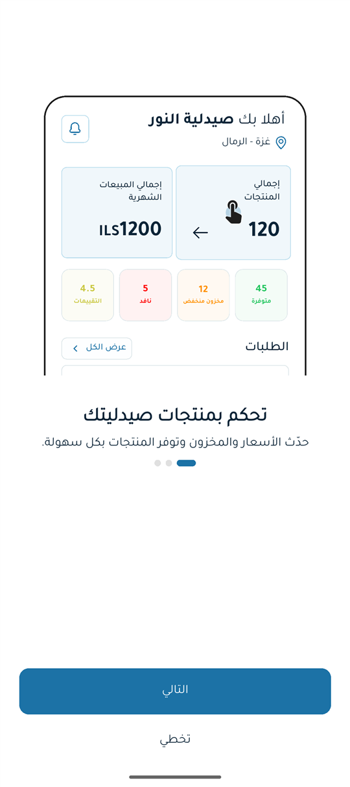
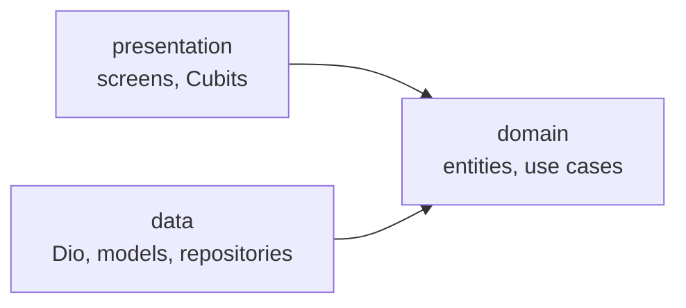
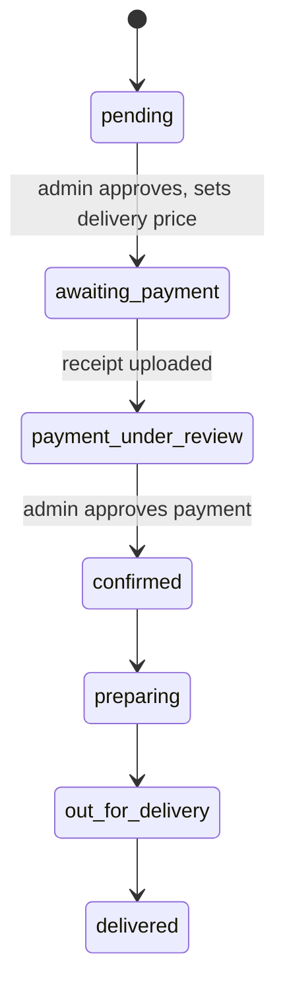

# Dawak (دواك)

**A mobile app that connects patients with pharmacies: find your medicine, see which pharmacy has it and for how much, and get it delivered. Pharmacies run their stock, orders, chat and accounting from the same app.**

**[العربية](README.ar.md)** · English

One app, two accounts: **User** (a patient who searches, orders and tracks) and **Pharmacist** (manages products, orders, chat and accounting). Arabic-first (right-to-left), with an English mode in Settings.

## Screenshots

From the release build on an Android emulator. The pictures inside the pharmacy onboarding are drawn with the app's own widgets and animate.

| Choose account | Patient sign in | Pharmacy sign in | Pharmacy sign up |
|:--:|:--:|:--:|:--:|
|  |  |  |  |

| Patient onboarding | | | Pharmacy onboarding | | |
|:--:|:--:|:--:|:--:|:--:|:--:|
|  |  |  |  |  |  |

## Features

**Patients**
- Search by medicine name or by symptom, browse categories, filter by form.
- See which pharmacies have a medicine, the price, distance and opening state; get notified when it is back in stock.
- Ask a pharmacy before buying; chat with pharmacies and a smart assistant.
- Favorites, map of nearby pharmacies, medicine reminders, health profile, addresses.
- Cart (one pharmacy per order), delivery price shown before confirming, bank-transfer payment with receipt upload, order tracking, pharmacy rating.
- Settings: language, permissions, support, delete account.

**Pharmacies** (join by sign-up, then the Dawak team approves and sends the pharmacy ID and password)
- Home with key numbers and the latest orders.
- Products: add, edit, delete, change quantities, update from Excel, set alternatives for out-of-stock items.
- Orders (view only), chat with patients, ratings.
- Accounting: sales and PDF invoices, returns, cash drawer, phone as a barcode scanner.
- Settings: details, location, working hours, password, account closure.

## Status

- **Working:** both accounts, ordering with bank transfer, tracking, chat, stock, accounting, English mode.
- **Not yet:** the patient Scan tab (needs an image-to-product API), sending a prescription to a pharmacy, pharmacy "forgot password" (no backend endpoints), moving order status from the pharmacy, card payment.
- **Temporary:** the verification code is shown on screen until SMS is live.

## For developers

**Stack:** Flutter (stable, tested on 3.47) and Dart `^3.10.7`; `flutter_bloc` (Cubit only), `get_it`, `dio`, `flutter_secure_storage`, Firebase Messaging, Google Maps, `mobile_scanner`, `pdf`. No code generation: no Freezed, no build_runner.

**Architecture:** Clean Architecture, one direction only.



- A Cubit depends on **use cases only**. `domain` is pure Dart (no `package:flutter`).
- `data` catches exceptions and returns `ApiResult<T>` (`Success` / `ApiError`).
- Code used in two places goes in `core/`.

```
lib/
├─ core/        di, networking, erroring, localization, routing, theming, widgets, helpers
└─ features/    auth, patient, pharmacy, accounting, chat, scanner, onboarding, localization
                each: data/ (datasources, models, repositories)
                      domain/ (entities, repositories, usecases)
                      presentation/ (cubit, screens, widgets)
test/           mirrors lib; test/helpers has shared fakes
```

**Run it**

```bash
git clone https://github.com/daway-app/daway-mobile.git && cd daway-mobile
cp .env.example .env     # API_BASE_URL (ends with /api) and the Cloudinary values
flutter pub get
flutter run
```

Add `MAPS_API_KEY=...` to `android/local.properties`. `.env` and `local.properties` are not in git; `.env` is bundled into the app, so keep secrets out of it.

```bash
flutter analyze          # must be clean
flutter test             # ~1600 tests
flutter run --dart-define=ACCOUNTING_SAMPLE=true      # accounting with sample data
flutter build apk --release --target-platform android-arm64 --split-per-abi \
  --obfuscate --split-debug-info=build/symbols        # small release, about 38 MB
```

Release signing: copy `android/key.properties.example` to `android/key.properties` (keystore outside the repo). Without it the release is signed with the debug key.

**Backend**
- Paths are in `lib/core/constants/api_constants.dart`; auth is `Authorization: Bearer <token>`; responses are `{ success, message, data, pagination? }`.
- A 401 on a request with a token clears the session and returns to the account chooser. For 5xx the app shows its own message, not the server's.
- `ResponseCacheInterceptor` caches chosen GET routes (max 2 MB, cleared with the session).
- Checkout: `POST /patient/checkout/quote`, then `quoted_*` fields plus an `idempotency_key`. Order stages: [BACKEND_ORDER_FLOW.md](BACKEND_ORDER_FLOW.md) (Arabic).



**Localization.** Texts are written in Arabic with `.tr` (`'نص {0}'.trArgs([x])`); the English tables are in `lib/core/localization/en/`, keyed by the Arabic text. A test fails if a `.tr` text has no English. No `const` around `.tr`, and never `.tr` on text sent to the backend. Use `start`/`end` (not `left`/`right`) and `MirrorWhenLtr` for arrows.

**Code rules**
- Smallest change that solves the problem; fix causes, not symptoms.
- Use the shared tools: `withSessionToken` (use cases), `guardApi` (repositories), `authFieldDecoration()`, `networkImage()`.
- `const` where possible; no controllers in `build()`; `setState` only for local UI state.
- Tests for domain and data; a bug fix comes with a test that reproduces it; one behavior per test.

**Security.** No secrets in code or git; backup and cleartext are disabled; reminders are in secure storage. Open items: restrict the Maps key and the Cloudinary preset, rate-limit `/otp/send` and `/login/pharmacy`.

**Git.** Branches `feature/`, `fix/`, `refactor/`, `docs/` off `develop`. CI (`.github/workflows/dart.yml`) runs `flutter analyze` and `flutter test` on pushes and PRs to `develop`.

**Adding a feature.** Create `features/<name>/{data,domain,presentation}`: entity and use case (domain), datasource, model and repository (data), Cubit and screen (presentation). Register it in `core/di/dependency_injection.dart` and `AppRouter`, add the English texts, write the tests, run `flutter analyze` and `flutter test`.

Repository: <https://github.com/daway-app/daway-mobile>
