# Dawak 💊 (دواك)

**A mobile app that connects patients with pharmacies: find your medicine, see which pharmacy has it and for how much, and get it delivered. Pharmacies run their stock, orders, chat and accounting from the same app.**

🌐 **[العربية](README.ar.md)** · English

<p align="center">
  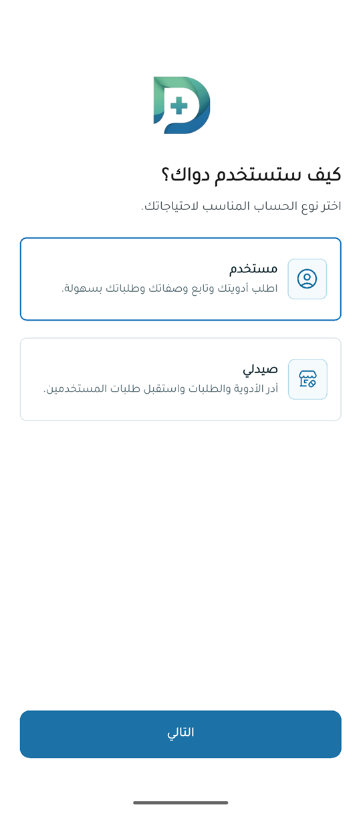
  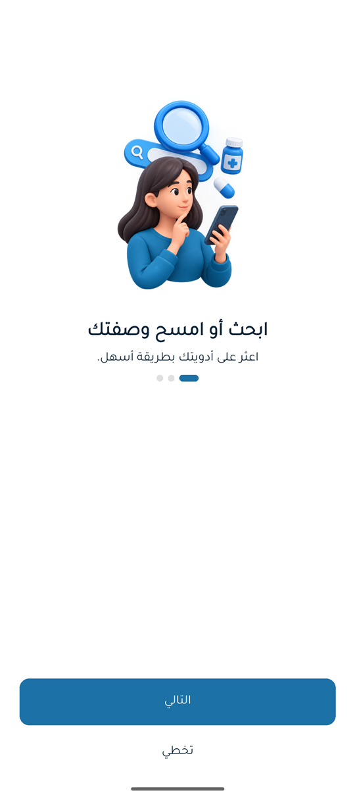
  
  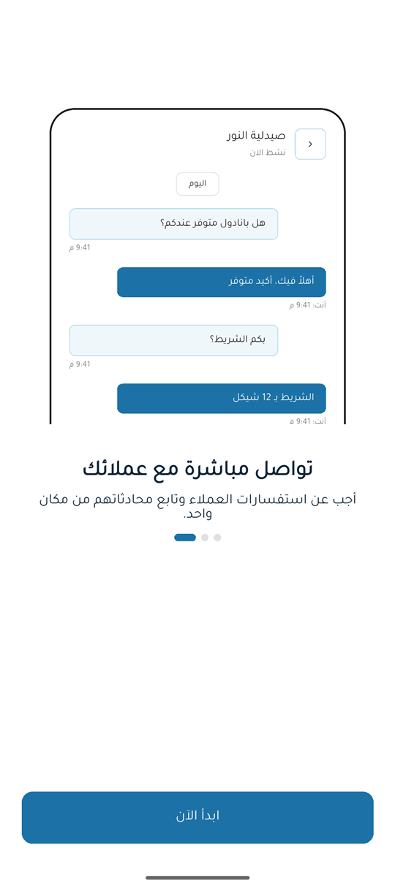
</p>

## Contents

1. [What is Dawak?](#1-what-is-dawak)
2. [Screenshots](#2-screenshots)
3. [For patients](#3-for-patients)
4. [For pharmacies](#4-for-pharmacies-our-customers)
5. [Project status](#5-project-status)
6. [For developers](#6-for-developers)
   - [Tech stack](#61-tech-stack) · [Architecture](#62-architecture) · [Folder structure](#63-folder-structure) · [Getting started](#64-getting-started) · [Commands](#65-useful-commands) · [Backend](#66-talking-to-the-backend) · [Localization](#67-localization) · [Code rules](#68-code-rules) · [Testing](#69-testing) · [Security](#610-security) · [Git workflow](#611-git-workflow) · [Adding a feature](#612-adding-a-feature)

---

## 1) What is Dawak?

**The problem:** when you need a medicine you go from one pharmacy to the next, calling to ask "do you have it?", and lose time. Pharmacies, on their side, manage stock and orders on paper or with scattered tools.

**The solution:** one app with two accounts.

| Account | Who uses it | What it does |
|---|---|---|
| **User** (patient) | Anyone who needs a medicine | Search, compare pharmacies, order, track the order |
| **Pharmacist** | A pharmacy owner or staff | Manage products and stock, orders, chat and accounting |

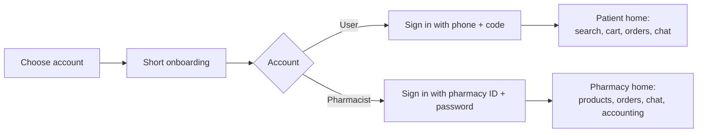

The app is **Arabic-first (right-to-left)** and has an **English mode** (Settings → Language).

---

## 2) Screenshots

Taken from the real release build running on an Android emulator (Pixel 9). The pictures inside the pharmacy onboarding are drawn with the app's own widgets (and animate: a finger taps the products card, order cards slide in, chat messages arrive one by one).

**Getting in**

| Choose an account | Patient sign in | Pharmacy sign in | Pharmacy sign up |
|:--:|:--:|:--:|:--:|
|  | 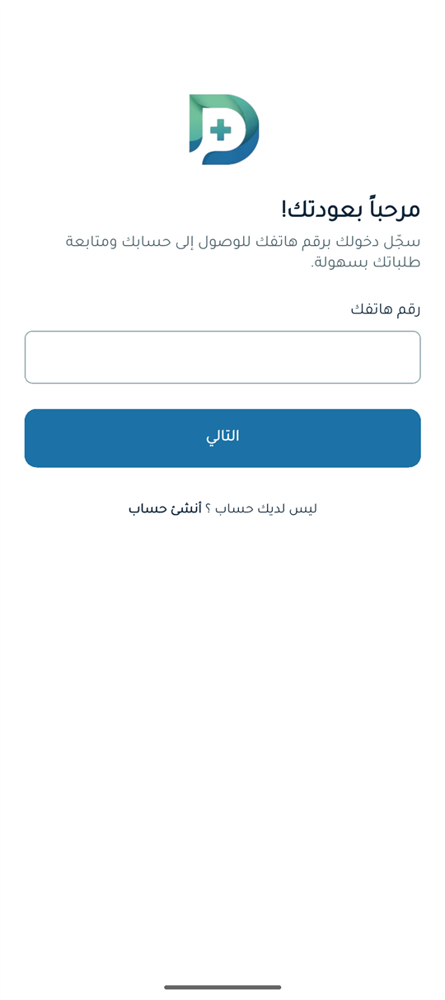 | 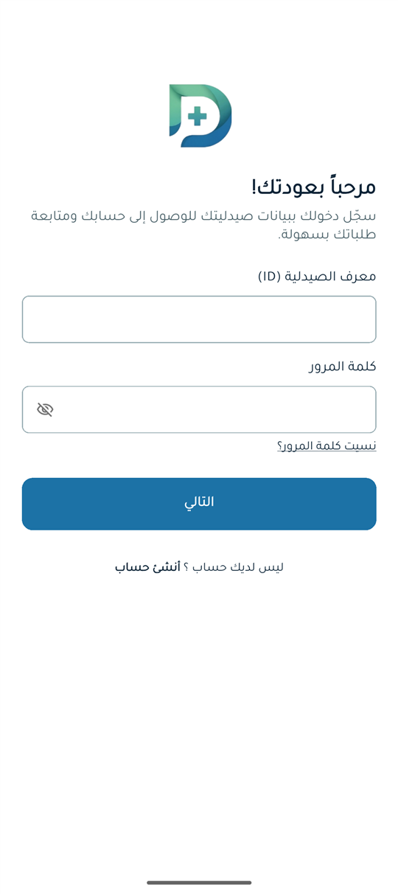 | 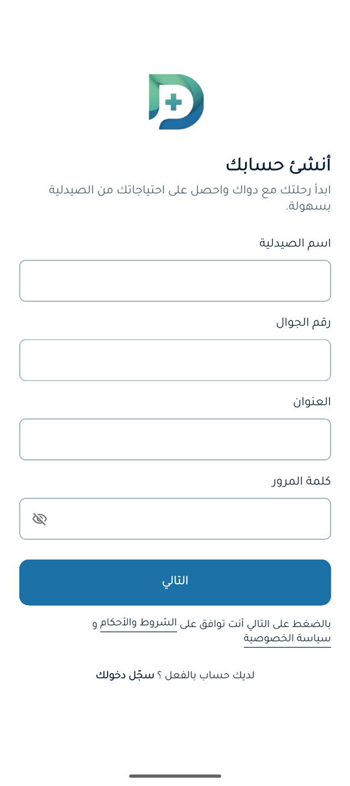 |

**Patient onboarding**

| Search or scan | Compare pharmacies | Order from several pharmacies |
|:--:|:--:|:--:|
|  | 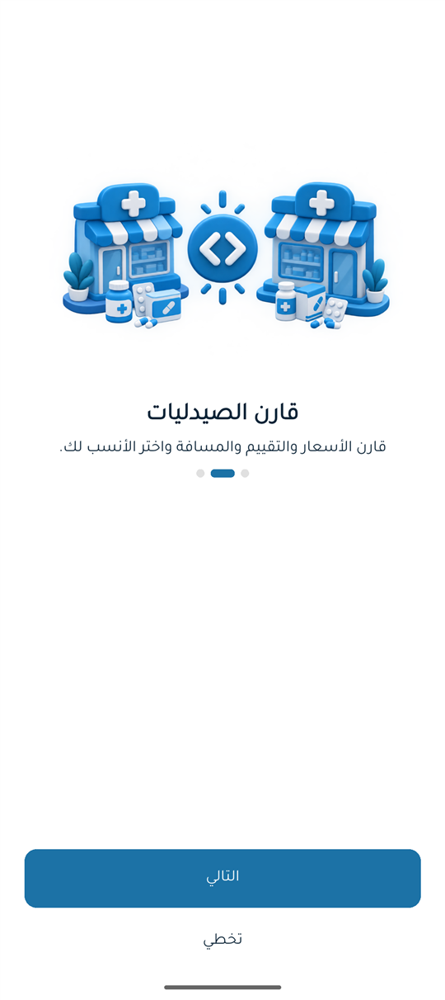 | 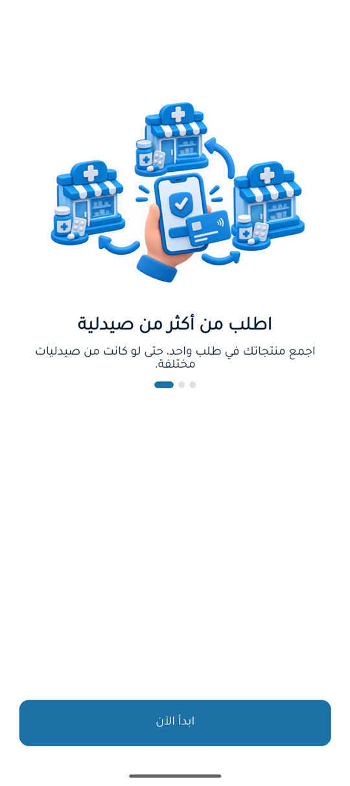 |

**Pharmacy onboarding**

| Control your products | Receive orders | Talk to customers |
|:--:|:--:|:--:|
|  | 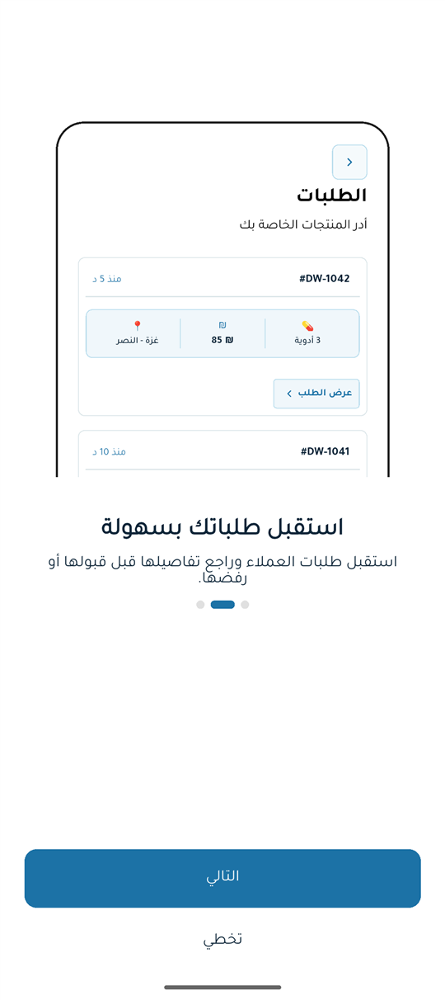 |  |

---

## 3) For patients

### Getting started
1. Open the app and choose **User**.
2. Enter your mobile number (starts with `05`, 10 digits) and the verification code.
3. First time? Enter your name and date of birth, accept the terms, then allow location (to find the nearest pharmacies) and notifications.

### What can I do?

| Feature | What it does |
|---|---|
| **Search** | Type a medicine name, or type "what do you feel". Or browse categories: Medicines, Dental Care, First Aid, Mother & Baby, Skin Care & Beauty, Medical Supplies, Eye Care, Health & Safety, Vitamins & Supplements. Filter by medicine form. |
| **Medicine page** | Which pharmacies have it, the price at each, whether they are open now, how far they are. |
| **"Notify me when available"** | If it is out of stock, the app tells you when it is back. |
| **Ask the pharmacy** | Message a pharmacy before you buy. All your conversations are in the **Messages** tab. |
| **Favorites** | Save the medicines you need often. |
| **Map** | The nearest pharmacies, with call and directions buttons. |
| **Cart and checkout** | Add medicines, choose a delivery address, enter a discount code, and see the delivery price and total **before** you confirm. One pharmacy per order. |
| **Payment** | Bank transfer: pick the bank and upload a photo of the transfer receipt (or type the transfer details if the upload fails). |
| **Order tracking** | Confirmed → preparing → on the way → delivered. After delivery you can rate the pharmacy. |
| **Medicine reminders** | Set a medicine and a time (daily, every 12 h, or every 6 h) and get notified. |
| **Health profile** | Blood type, allergies, chronic conditions, to help the pharmacist suggest the right medicine. |
| **Smart assistant** | Ask about any medicine and it points you to the pharmacies that have it. |
| **My account** | Addresses, notifications, support (WhatsApp or call), settings. |

### Privacy
- In **Settings** you can change the language, control location and notification permissions, and read the privacy policy and terms.
- **Delete account** is in Settings and removes your account and data permanently.

### FAQ
- **I did not get the code.** Check the number and use "Resend code" when the countdown ends.
- **Why can't I order from two pharmacies at once?** Pharmacies can be far from each other. The app asks you to pick one and removes the rest from the cart.
- **Why did the delivery price change?** It is calculated from your address. If it changes before you confirm, the app shows the new total and asks you to confirm again.

---

## 4) For pharmacies (our customers)

### How to join
1. Choose **Pharmacist → Create account** and enter the pharmacy name, phone, address (on the map) and a password (8+ characters).
2. Your account is **under review** by the Dawak team.
3. Once approved you receive your **pharmacy ID** and password and sign in with them.

### What can I do?

| Section | What it does |
|---|---|
| **Home** | Your numbers at a glance: total products, monthly sales, in stock / low / out, your rating, and the latest orders. |
| **Products** | Add, edit and delete products, change quantities, search and filter (in stock / low / out). |
| **Excel update** | Download the template, fill in your products, upload it and review the result (updated / new / with errors) before applying. You can also export your current products. |
| **Orders** | Each order's details: number, customer, medicines with quantity and price, and payment status. View only: order stages are moved by the Dawak team. |
| **Messages** | Answer patients' questions (text and photos). |
| **Alternatives** | Set an alternative with the same active ingredient for a medicine that is out of stock. |
| **Ratings** | See what customers say about you. |
| **Accounting** | Overview, sales invoices (new sale by barcode, share the invoice as PDF), returns, cash drawer, and use your phone as a barcode scanner for the website's sales screen. |
| **Settings** | Pharmacy details, location, working hours, change password, language, and request account closure. |

---

## 5) Project status

| Feature | Status |
|---|---|
| Patient and pharmacy accounts, ordering and bank-transfer payment, tracking, chat, stock, accounting | ✅ Working |
| English mode (texts, plus category names from the backend) | ✅ Working |
| **Scan** tab for patients (photograph a box or prescription) | ⏳ "Coming soon": needs an API that takes the picture and returns the product |
| Sending a prescription to the nearest pharmacy | ⏳ Not built (the building blocks exist, the design decision is open) |
| "Forgot password" for pharmacies | ⏳ Screens are ready, the backend has no endpoints yet |
| Moving an order's status from the pharmacy (accept / prepare) | ❌ Not available; the Dawak team moves it |
| Online card payment | ❌ Bank transfer only for now |
| Verification code | ⚠️ The backend returns it and the app shows it on screen **temporarily**, until SMS is live |

---

## 6) For developers

### 6.1) Tech stack

| Area | Tool |
|---|---|
| Language and framework | Dart `^3.10.7`, Flutter (stable, tested on 3.47) |
| State management | `flutter_bloc` (**Cubit only**), `sealed class` states |
| Dependency injection | `get_it` (one file: `lib/core/di/dependency_injection.dart`) |
| Networking | `dio` with interceptors (session expiry, response cache) |
| Storage | `flutter_secure_storage` (token, reminders), `shared_preferences` (language) |
| Maps and location | `google_maps_flutter`, `geolocator`, `geocoding` |
| Notifications | `firebase_messaging`, `flutter_local_notifications` (reminders) |
| Images | `cached_network_image` + Cloudinary (unsigned upload) |
| Files | `file_picker`, `excel`, `pdf` (Tajawal font embedded), `share_plus` |
| Barcode | `mobile_scanner` |
| UI | `flutter_screenutil` (design 440×956), `flutter_svg`, `google_fonts` |

> **No code generation:** no Freezed, no build_runner. We use `sealed class`, `switch` expressions and records.

### 6.2) Architecture

Clean Architecture; dependencies point one way only.

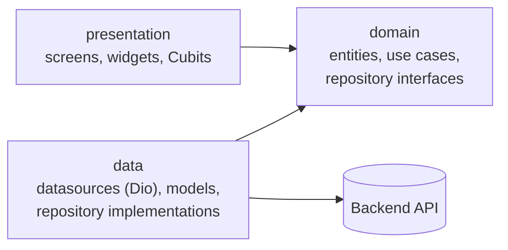

| Layer | Contains | Rules |
|---|---|---|
| `presentation` | Screens, widgets, Cubits and their states | No business logic. A Cubit depends on **use cases only**, never on repositories |
| `domain` | Entities, repository interfaces, use cases | **Pure Dart**, no `package:flutter` |
| `data` | Datasources, JSON models, repository implementations | Catches exceptions and maps them to typed `Failure`s |

Error path: `data` catches → `ApiResult<T>` (`Success` / `ApiError`) → use case → Cubit → a friendly message in the UI.

### 6.3) Folder structure

```
lib/
├─ main.dart            entry point (Firebase, .env, DI, saved language)
├─ app.dart             MaterialApp, locale and direction
├─ core/                shared by all features
│  ├─ constants/        API paths and app constants
│  ├─ di/               get_it registration
│  ├─ erroring/         Failure, mapExceptionToFailure, guardApi
│  ├─ helpers/          small helpers (dates, prices, JSON, ...)
│  ├─ localization/     the .tr system and the English tables
│  ├─ networking/       Dio, response cache, session-expiry interceptor
│  ├─ routing/          router and screen names
│  ├─ services/         local notifications and push
│  ├─ theming/          colors, fonts, text styles
│  └─ widgets/          shared widgets
└─ features/
   ├─ auth/             sign in, sign up, OTP, session, account closure
   ├─ patient/          everything for the patient
   ├─ pharmacy/         everything for the pharmacy
   ├─ accounting/       accounting (pharmacy)
   ├─ chat/             conversations and the smart assistant
   ├─ scanner/          pairing a phone as a barcode scanner
   ├─ onboarding/       intro screens
   └─ localization/     saving the chosen language

each feature:  data/{datasources,models,repositories}
               domain/{entities,repositories,usecases}
               presentation/{cubit,screens,widgets,helpers}

test/                   mirrors lib; test/helpers has shared test tools
```

The router is `lib/core/routing/app_router.dart` and the screen names are in `routes.dart`. Routes are unnamed (`settings.name` is null), so navigate structurally.

### 6.4) Getting started

**Requirements:** Flutter (stable), Android Studio with the Android SDK, JDK 17.

```bash
git clone https://github.com/daway-app/daway-mobile.git
cd daway-mobile
cp .env.example .env          # then edit the values (see the table)
flutter pub get
flutter run
```

| File | Content | Note |
|---|---|---|
| `.env` | `API_BASE_URL` (ends with `/api`), `CLOUDINARY_CLOUD_NAME`, `CLOUDINARY_UPLOAD_PRESET`, `CLOUDINARY_DEFAULT_AVATAR_URL` | **Not tracked by git.** It is bundled into the app, so never put secrets in it |
| `android/local.properties` | `MAPS_API_KEY=...` | Google Maps key. Not tracked. Restrict it by package name and SHA-1 |
| `android/app/google-services.json` | Firebase config | Already in the repo |

### 6.5) Useful commands

```bash
flutter analyze                 # must say "No issues found"
flutter test                    # all tests (~1600)
flutter test test/features/patient          # one folder

# see the accounting screens with sample data, no backend needed
flutter run --dart-define=ACCOUNTING_SAMPLE=true

# small release build (arm64 only, obfuscated): about 38 MB
flutter build apk --release --target-platform android-arm64 --split-per-abi \
  --obfuscate --split-debug-info=build/symbols

# app icon and splash screen
dart run flutter_launcher_icons
dart run flutter_native_splash:create
```

- **Release signing:** copy `android/key.properties.example` to `android/key.properties` and fill it in (keep the keystore **outside** the repo). Without it the release build is signed with the debug key and is not for publishing.
- Keep `build/symbols` with every obfuscated build; you need it to read stack traces.

### 6.6) Talking to the backend

- **Base URL:** `API_BASE_URL` from `.env`. All paths live in `lib/core/constants/api_constants.dart`.
- **Auth:** `Authorization: Bearer <token>`. The token is in secure storage and is cleared on logout.
- **Response shape:** `{ success, message, data, pagination? }`. Lists come in pages of 20 (fixed by the backend).
- **Errors:** `mapExceptionToFailure` turns an exception into a `Failure`. The server's own message is shown for 4xx only; for 5xx the app's own wording is shown.
- **Session expiry:** any 401 on a request that carried a token clears the session, shows a dialog and returns to the account chooser.
- **Cache:** `ResponseCacheInterceptor` keeps GET answers of chosen routes (max 2 MB / 40 files, cleared with the session). Categories are served from cache for an hour, medicines for two minutes; the user's own lists are always fetched and only fall back to the cache offline.
- **Order and payment:** the backend computes price and delivery. The app calls `POST /patient/checkout/quote`, then sends `quoted_*` fields with an `idempotency_key`; `409 quote_changed` triggers a re-quote.

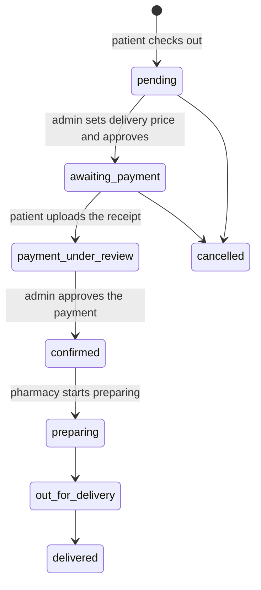

The stages the app expects from the backend are described in [BACKEND_ORDER_FLOW.md](BACKEND_ORDER_FLOW.md) (in Arabic).

### 6.7) Localization

Arabic is the base; English is a table keyed by the Arabic text itself.

```dart
Text('إتمام الطلب'.tr)                        // a fixed text
Text('طلب رقم {0}'.trArgs([order.number]))    // a text with a value
```

- Tables are in `lib/core/localization/en/*.dart`. A text with no translation shows in Arabic (never blank).
- `test/core/localization/translations_test.dart` **fails** if a `.tr` text has no English entry.
- Do not put `const` around `.tr`; constants that hold texts must be getters.
- Never use `.tr` on a text that is sent to the backend or compared against.
- Layout direction is automatic: use `start`/`end`, `EdgeInsetsDirectional` and `AlignmentDirectional`, never `left`/`right`. Wrap direction-sensitive icons (arrows, back) in `MirrorWhenLtr`.
- Category names come from the backend (`name_ar` / `name_en`) and are shown through `.name`.

### 6.8) Code rules

1. **The smallest change that solves the problem**, and fix causes, not symptoms.
2. **Pure domain:** no `package:flutter` under `domain/`.
3. **Code used in two places belongs in `core/`.** Search it before writing anything new.
4. **Use the shared tools instead of rewriting the pattern:**
   - `withSessionToken` / `withSession` for use cases: `lib/features/auth/domain/usecases/with_session_token.dart`
   - `guardApi` for repositories: `lib/core/erroring/error_handler.dart`
   - `authFieldDecoration()` for sign-in fields, `AccountingStyles.inputDecoration()` for accounting fields
   - `networkImage(url)` for pictures (disk cache), `formatPrice` for prices
5. **Build methods:** `const` where possible, never create controllers inside `build()`, dispose them in `dispose()`.
6. **`setState`** only for local UI state (toggles, focus), in the smallest widget.
7. **Security:** no secrets in code, no sensitive logging, validate every external input.

### 6.9) Testing

- About **243 files** and **1600+ tests**. Domain and data tests are mandatory, and a bug fix comes with a test that reproduces it.
- One behavior per test; nothing flaky or time-dependent.
- Shared tools in `test/helpers/`: `InMemorySessionRepository` (an in-memory session) and `buildArabicTestApp` (an RTL test app at the design size).
- Screens that use `get_it`: register fakes in `setUp` and call `getIt.reset()` in `tearDown`.
- A screen with a `CircularProgressIndicator` cannot use `pumpAndSettle`; use `pump(Duration)`.

### 6.10) Security

- `.env`, `local.properties`, `key.properties` and the keystore are outside git.
- App backup is disabled (`allowBackup=false`) and cleartext traffic is blocked.
- Reminders (medicine names) are kept in secure storage.
- **Known and temporary:** the verification code is shown on screen (`otp_verification_form.dart`); remove it when SMS is live.
- **Open recommendations:** restrict the Maps key and the Cloudinary preset, upload chat pictures through the backend instead of a public link, and rate-limit `/otp/send` and `/login/pharmacy` on the backend.

### 6.11) Git workflow

- **Branches:** `feature/...`, `fix/...`, `refactor/...`, `docs/...`. The base is `develop`.
- **CI** (`.github/workflows/dart.yml`): `flutter analyze` then `flutter test` on every push and pull request to `develop`.
- Before merging: clean `flutter analyze` and `flutter test`, a code review, and a Markdown PR description.

### 6.12) Adding a feature

1. Create `features/<name>/{data,domain,presentation}`.
2. **domain:** the entity, the repository interface and the use case (with `withSessionToken`).
3. **data:** the datasource (Dio), the model and the repository (with `guardApi`). Add the path to `api_constants.dart`.
4. **presentation:** the Cubit (depending on use cases only) with `sealed` states, then the screen. Register the screen in `AppRouter`.
5. **Register everything** in `core/di/dependency_injection.dart`.
6. **Texts:** write them in Arabic with `.tr` and add the English in `core/localization/en/`.
7. **Tests:** for the use case, the repository and the Cubit, and for the screen when it has behavior.
8. Run `flutter analyze` and `flutter test`.

---

**Repository:** <https://github.com/daway-app/daway-mobile>
